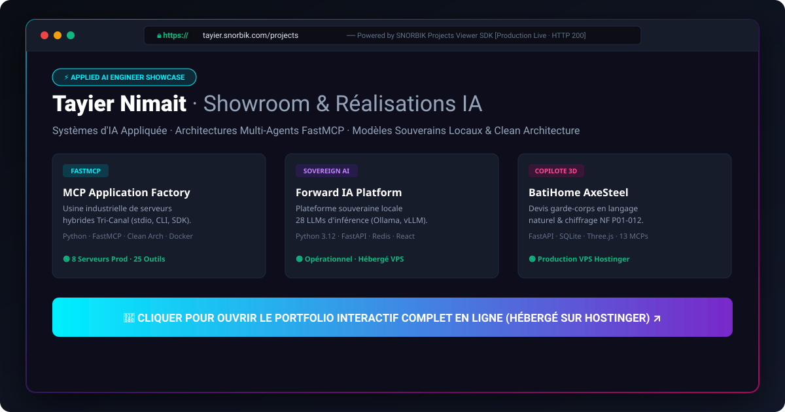
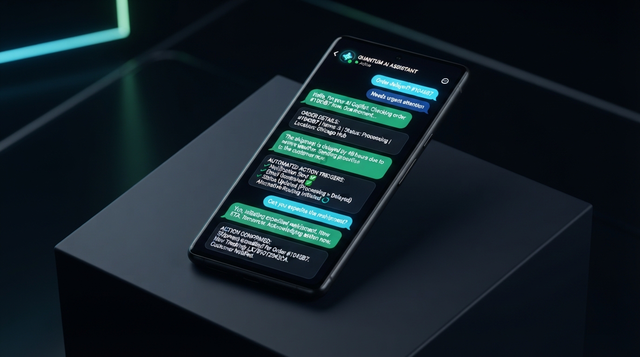
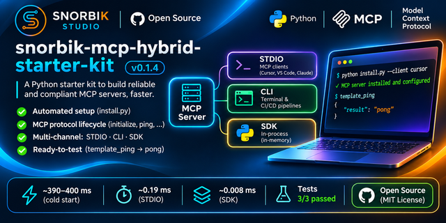
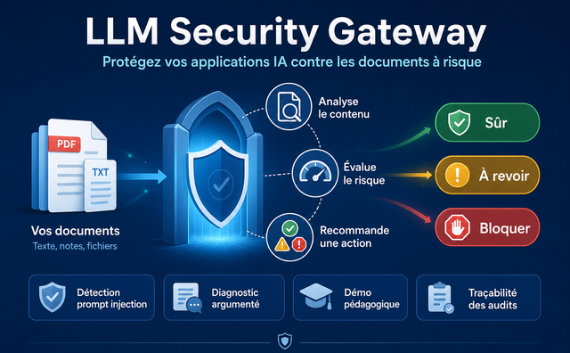
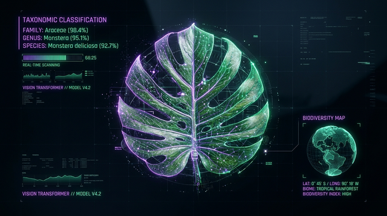
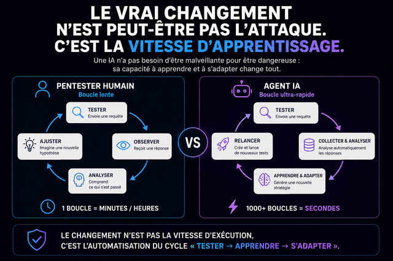
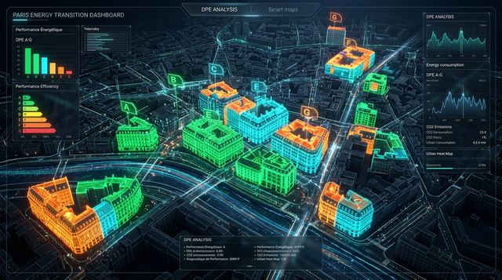
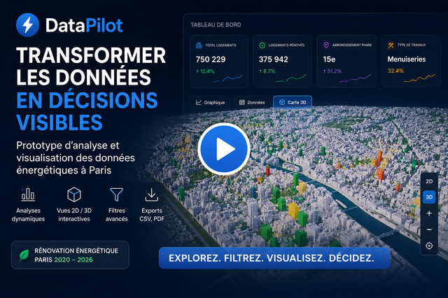

# ⚡ Tayier Nimait — AI Builder, Applied AI Engineer & Web/AI Studio (SNORBIK)
### Founder @ **SNORBIK Studio** ([snorbik.com](https://snorbik.com)) · Sites Web SEO/GEO, MVP SaaS, Serveurs FastMCP & Agents IA — Paris / Île-de-France, France 🇫🇷

*"J'aide les entreprises, dirigeants, fondateurs et équipes tech à concevoir et déployer rapidement leurs sites internet haute conversion (SEO/GEO), MVP SaaS, serveurs FastMCP et agents IA autonomes."*

 

<!-- ======================================================================= -->
<!-- 1. VITRINE IMMÉDIATE (PREMIER ÉCRAN DESKTOP — ZERO SCROLL)             -->
<!-- ======================================================================= -->

  
  &nbsp;&nbsp;
  
  &nbsp;&nbsp;
  

---

## 💼 Mes 4 Branches de Solutions & Services (`80 % Business`)

De l'acquisition client à l'automatisation interne, **SNORBIK Studio** conçoit des solutions numériques clé-en-main orientées ROI, souveraineté des données (RGPD / AI Act) et rapidité de mise en production :

| Branche de Service | Problème Résolu & Bénéfice Client | Livrables Clés | Accès / Démo |
| :--- | :--- | :--- | :--- |
| **🌐 1. Sites Internet & Vitrines Haute Conversion (SEO / GEO)** | Transformer votre visibilité Google et apparaître en priorité dans les réponses des IA (**ChatGPT Search, Perplexity, Gemini, Claude**). **Dès 700 € HT** — mise en ligne rapide. | Vitrines React/Vite ultra-rapides, pages locales (`/geo`), fichiers `llms.txt`, `robots.txt`, `sitemap.xml`, `Schema.org` & **SNORBIK Geo-SEO SDK**. | [**snorbik.com/solutions** ↗](https://snorbik.com/solutions) |
| **🚀 2. MVP & Applications Web / SaaS Clé-en-Main** | Passer d'une idée métier à un produit rentable et déployé sans dette technique ni délais interminables (**1er livrable sous 10 jours ouvrés**). | Interfaces **React 19 / TypeScript** (architecture DPN-IA), API **FastAPI / Python**, bases PostgreSQL / SQLite & déploiement Docker hermétique. | [**snorbik.com/catalogue** ↗](https://snorbik.com/catalogue) |
| **🔌 3. Serveurs MCP & Connecteurs d'Entreprise (FastMCP)** | Connecter en toute sécurité **Claude, Cursor** et vos copilotes IA directement à vos bases SQL, devis, ERP, PDFs et outils internes. | Serveurs **FastMCP Hybrides Tri-Canal** (`STDIO` / `CLI` / `SDK`), validation Pydantic stricte, garde-fous déterministes et zéro hallucination métier. | [**tayier.snorbik.com/docs** ↗](https://tayier.snorbik.com/docs) |
| **🤖 4. Agents IA & Automatisation Métier** | Supprimer les tâches répétitives (prise de RDV, chiffrage, extraction PDF/RAG, support client) tout en gardant le contrôle total sur vos données. | Copilotes split-screen temps réel, flottes multi-agents synchronisées, pipelines RAG hybrides et inférence locale **On-Premise (Ollama / vLLM)**. | [**snorbik.com/rendez-vous** ↗](https://snorbik.com/rendez-vous) |

---

## 🏆 6 Projets Phares Orientés Résultats Clients

Chaque réalisation répond à une problématique opérationnelle concrète suivant le format **Problème Client ➔ Solution Déployée ➔ Résultat Business**.

<table>
  <tr>
    <td width="50%" valign="top">
      
       
      <h4>🏗️ <a href="https://github.com/snorbik-ai/axesteel-ecommerce-garde-corps-showcase">BatiHome AxeSteel 3D</a> (Branche 2 & 4 · MVP SaaS & Copilote BTP)</h4>
      
<b>Problème Client :</b> Le chiffrage manuel de garde-corps sur-mesure prenait jusqu'à 48h avec des risques d'erreurs sur les normes de sécurité.

      
<b>Solution Déployée :</b> Plateforme e-commerce 3D (React/Three.js + FastAPI) avec configurateur visuel, moteur déterministe <b>NF P01-012</b> et flotte de serveurs FastMCP.

      
<b>Résultat Business :</b> Génération de devis conformes et visualisés en quelques secondes, réduction des retours SAV et qualification automatique des prospects.

      

        
        
        
      

      

        <a href="https://github.com/snorbik-ai/axesteel-ecommerce-garde-corps-showcase"><b>📂 Dépôt Showcase ↗</b></a> &nbsp;•&nbsp;
        <a href="https://www.axesteel.fr/"><b>🌐 Site Client ↗</b></a>
      

    </td>
    <td width="50%" valign="top">
      
       
      <h4>🗓️ <a href="https://github.com/snorbik-ai/copilot-rdv-showcase">SNORBIK Copilot RDV</a> (Branche 4 · Agent IA de Réservation)</h4>
      
<b>Problème Client :</b> Les formulaires de contact statiques créent de la friction, des créneaux doubles et jusqu'à 60 % d'abandon prospect.

      
<b>Solution Déployée :</b> Assistant conversationnel et visuel Split-Screen temps réel relié à un serveur FastMCP avec vérification de disponibilités et export <b>iCal / RFC 5545</b>.

      
<b>Résultat Business :</b> Qualification intelligente des demandes dès la première visite et prise de rendez-vous confirmée 24h/24 sans intervention manuelle.

      

        
        
        
      

      

        <a href="https://github.com/snorbik-ai/copilot-rdv-showcase"><b>📂 Dépôt GitHub ↗</b></a> &nbsp;•&nbsp;
        <a href="https://snorbik.com/rendez-vous"><b>🧪 Tester Live ↗</b></a>
      

    </td>
  </tr>
  <tr>
    <td width="50%" valign="top">
      
       
      <h4>🤖 <a href="https://github.com/snorbik-ai/mcp-application-factory-showcase">SNORBIK Application Factory & Flotte MCP</a> (Branche 3 · Usine FastMCP)</h4>
      
<b>Problème Client :</b> Développer chaque connecteur IA de zéro coûte cher, reste limité à un seul IDE et complique les tests de non-régression.

      
<b>Solution Déployée :</b> Usine industrielle produisant des serveurs <b>FastMCP Hybrides Tri-Canal</b> (STDIO, CLI et SDK in-process) alignés Clean Architecture DDD.

      
<b>Résultat Business :</b> 28 serveurs spécialisés opérationnels (audit code, extraction PDF, devis, déploiement Docker) déployables dans Cursor, Claude et Antigravity.

      

        
        
        
      

      

        <a href="https://github.com/snorbik-ai/mcp-application-factory-showcase"><b>📂 Dépôt GitHub ↗</b></a> &nbsp;•&nbsp;
        <a href="https://tayier.snorbik.com/docs"><b>📖 Docs & Architecture ↗</b></a>
      

    </td>
    <td width="50%" valign="top">
      
       
      <h4>🛡️ <a href="https://github.com/snorbik-ai/llm-security-gateway-showcase">LLM Security Gateway</a> (Branche 3 & 4 · Cybersécurité IA & RGPD)</h4>
      
<b>Problème Client :</b> Les entreprises bloquent l'adoption des LLM par crainte de fuite de données confidentielles (PII) et d'attaques par Prompt Injection.

      
<b>Solution Déployée :</b> Pare-feu applicatif IA FastAPI + Ollama/FAISS effectuant le masquage PII déterministe et le filtrage d'injections avant inférence.

      
<b>Résultat Business :</b> Utilisation sécurisée des agents IA et modèles en entreprise avec traçabilité complète et conformité stricte RGPD / AI Act.

      

        
        
        
      

      

        <a href="https://github.com/snorbik-ai/llm-security-gateway-showcase"><b>📂 Dépôt GitHub ↗</b></a> &nbsp;•&nbsp;
        <a href="https://tayier.snorbik.com/projects"><b>🧪 Démo Live ↗</b></a>
      

    </td>
  </tr>
  <tr>
    <td width="50%" valign="top">
      
       
      <h4>📦 <a href="https://github.com/snorbik-ai/snorbik-projects-viewer-sdk-showcase">Projects Viewer SDK v2.0 & Geo-SEO Engine</a> (Branche 1 & 2 · Web, SEO/GEO & ASCA)</h4>
      
<b>Problème Client :</b> Les vitrines et portfolios souffrent d'une faible visibilité locale sur Google/IA et manquent de composants portables sans fuite de secrets.

      
<b>Solution Déployée :</b> SDK React 19 / TypeScript combinant intégration fail-closed (3 modes) et génération automatique SEO/GEO (<code>llms.txt</code>, <code>Schema.org</code>, pages locales, audit qualité <b>ASCA / CodeFocus</b>).

      
<b>Résultat Business :</b> Déploiement rapide de vitrines B2B/Ingénieur prêtes pour Google, ChatGPT Search et Perplexity avec zéro maintenance lourde.

      

        
        
        
      

      

        <a href="https://github.com/snorbik-ai/snorbik-projects-viewer-sdk-showcase"><b>📂 Dépôt Showcase ↗</b></a> &nbsp;•&nbsp;
        <a href="https://snorbik.com/geo"><b>🌐 Hub SEO/GEO ↗</b></a>
      

    </td>
    <td width="50%" valign="top">
      
       
      <h4>🏨 <a href="https://github.com/snorbik-ai/snorbik-industrial-ai-agent-factory-showcase">Industrial AI Agent Factory & Bio-Atlas</a> (Branche 2 & 4 · SaaS & Agents Métier)</h4>
      
<b>Problème Client :</b> Les secteurs réglementés (hôtellerie, santé, immobilier) peinent à connecter leurs workflows critiques à des agents IA fiables.

      
<b>Solution Déployée :</b> Architectures SaaS sectorielles reliant agents multi-outils MCP (conciergerie hôtelière #23, oncologie 3D <a href="https://github.com/snorbik-ai/bio-atlas-medical-showcase">Bio-Atlas Medical</a>) à une logique métier auditée.

      
<b>Résultat Business :</b> Prototypage rapide de MVP verticaux auditables, sécurisés et prêts pour la mise en production client.

      

        
        
        
      

      

        <a href="https://github.com/snorbik-ai/snorbik-industrial-ai-agent-factory-showcase"><b>📂 Agent Factory ↗</b></a> &nbsp;•&nbsp;
        <a href="https://github.com/snorbik-ai/bio-atlas-medical-showcase"><b>🧬 Bio-Atlas Medical ↗</b></a>
      

    </td>
  </tr>
</table>

---

## 🧪 Patrimoine R&D, Data, Audio & Infrastructure (Autres Démonstrateurs)

<b>📂 Cliquer pour explorer les autres réalisations R&D, Cybersécurité VPS, Data Lakehouse & Speech IA (Patrimoine SNORBIK)</b>

 

<table>
  <tr>
    <td width="50%" valign="top">
      
       
      <h4>🛡️ <a href="https://tayier.snorbik.com/projects">SNORBIK VPS Guardian AI</a></h4>
      
<i>Sentinelle d’autodéfense serveur propulsée par IA locale</i> — Agent autonome Bonsai-2b analysant les journaux Linux et appliquant des blocages iptables signés SHA-256 sans exposition cloud.

      
<a href="https://tayier.snorbik.com/projects"><b>🧪 Fiche Projet ↗</b></a>

    </td>
    <td width="50%" valign="top">
      
       
      <h4>🗺️ <a href="https://github.com/snorbik-ai/bio-atlas-agent-showcase">Bio-Atlas Agent (Cartographie Territoriale)</a></h4>
      
<i>Rénovation thermique du bâti parisien</i> — Ingestion in-memory DuckDB + PyArrow avec scoring multicritère des parcelles et rendu cartographique GeoJSON.

      
<a href="https://github.com/snorbik-ai/bio-atlas-agent-showcase"><b>📂 Dépôt GitHub ↗</b></a>

    </td>
  </tr>
  <tr>
    <td width="50%" valign="top">
      
       
      <h4>🧬 <a href="https://github.com/snorbik-ai/G-Genome-AI-Framework">G-Genome AI Framework</a></h4>
      
<i>Modélisation énergétique de 800k+ logements</i> — Pipeline Python/Pandas d'audit statistique déterministe avec cartographie thermique et indicateurs de dispersion.

      
<a href="https://github.com/snorbik-ai/G-Genome-AI-Framework"><b>📂 Dépôt GitHub ↗</b></a>

    </td>
    <td width="50%" valign="top">
      
       
      <h4>🖥️ <a href="https://tayier.snorbik.com/projects">Forward IA Platform (v4.0)</a></h4>
      
<i>Plateforme souveraine d'inférence locale</i> — Orchestration on-premise de 28 LLMs (Ollama / vLLM) avec télémétrie NVML GPU temps réel.

      
<a href="https://tayier.snorbik.com/projects"><b>🧪 Démo Live ↗</b></a>

    </td>
  </tr>
  <tr>
    <td width="50%" valign="top">
      
       
      <h4>⚡ <a href="https://tayier.snorbik.com/projects">DataPilot AI — Moteur In-Memory</a></h4>
      
<i>Analyse in-memory DuckDB + PyArrow sub-100ms</i> — Copilote déterministe de requêtage sémantique sur grands volumes de données.

      
<a href="https://tayier.snorbik.com/projects"><b>🧪 Démo & Fiche Projet ↗</b></a>

    </td>
    <td width="50%" valign="top">
      
       
      <h4>🎙️ <a href="https://www.youtube.com/@SNORBIKStudio">VoxExtract Studio, listen-doc</a> &amp; <a href="https://github.com/snorbik-ai/projet-CarBook-Asp.net-8.0-2025">Enterprise .NET 8 / Django</a></h4>
      
<i>Speech IA local &amp; fondations Backend</i> — Transcription Whisper, synthèse vocale Kokoro ONNX / F5-TTS sub-50ms et API distribuées Clean / Onion Architecture.

      
<a href="https://www.youtube.com/@SNORBIKStudio"><b>🎥 Démos Vidéo ↗</b></a> &nbsp;•&nbsp; <a href="https://github.com/snorbik-ai/projet-CarBook-Asp.net-8.0-2025"><b>📂 Dépôt .NET 8 ↗</b></a>

    </td>
  </tr>
</table>

---

## 🛠️ Stack Technique Condensée (`20 % Tech`)

- **Web, Vitrines SEO/GEO & MVP :** React 19, TypeScript, Next.js / Vite, Tailwind CSS, Three.js / WebGL, `Schema.org`, `llms.txt`, SNORBIK Geo-SEO SDK.
- **IA, Serveurs MCP & Agents :** Python 3.12, FastAPI, Pydantic V2, **FastMCP** (Tri-Canal STDIO/CLI/SDK), LangGraph, RAG Hybride (DuckDB, ChromaDB, FAISS), Ollama, vLLM, Whisper, Kokoro ONNX.
- **Infrastructure & Qualité Industrielle :** Docker hermétique, Traefik / Nginx TLS, Linux VPS souverain, PostgreSQL / SQLite, Clean Architecture DDD (**ASCA**), UI DPN-IA & audit pré-CICD **CodeFocus** (0 token perdu).

---

## 🇬🇧 English Overview — SNORBIK AI Studio & Applied AI Engineering

**Tayier Nimait** is an **AI Builder, Applied AI Engineer & Full-Stack Developer** based in **Paris / Île-de-France, France**, and founder of **SNORBIK Studio** ([snorbik.com](https://snorbik.com)).

I help companies, founders, and engineering teams design and ship production-ready software across **4 core service branches**:

1. **🌐 High-Conversion Websites (SEO & GEO Ready):** Fast React/Vite storefronts engineered for Google ranking and AI search visibility (`llms.txt`, `robots.txt`, `sitemap.xml`, `Schema.org` JSON-LD).
2. **🚀 SaaS & Web MVP Development:** End-to-end delivery from business specs to deployed product in **10 business days** (`React`, `TypeScript`, `FastAPI`, `Python`, `PostgreSQL`, `Docker`).
3. **🔌 Custom FastMCP Servers & AI Tooling:** Tri-channel (`STDIO`, `CLI`, `SDK`) **Model Context Protocol** connectors linking Claude, Cursor, and enterprise AI agents safely to SQL databases, PDFs, ERPs, and business rules.
4. **🤖 Autonomous AI Agents & Business Automation:** Split-screen booking assistants, deterministic 3D/compliance quoting copilots, hybrid RAG pipelines, and sovereign local LLM inference (`Ollama`, `vLLM`).

### Highlighted Public Repositories
- [`mcp-application-factory-showcase`](https://github.com/snorbik-ai/mcp-application-factory-showcase) — Industrial factory for Tri-Channel FastMCP servers & hybrid runtimes (`mcp`, `fastmcp`, `clean-architecture`).
- [`llm-security-gateway-showcase`](https://github.com/snorbik-ai/llm-security-gateway-showcase) — AI application firewall with PII sanitization & prompt-injection detection (`fastapi`, `llm-firewall`).
- [`copilot-rdv-showcase`](https://github.com/snorbik-ai/copilot-rdv-showcase) — Split-screen conversational AI booking copilot with RFC 5545 calendar sealing (`ai-agents`, `fastmcp`, `react`).
- [`axesteel-ecommerce-garde-corps-showcase`](https://github.com/snorbik-ai/axesteel-ecommerce-garde-corps-showcase) — 3D SaaS configurator & deterministic NF P01-012 quoting copilot (`ecommerce-saas`, `react-typescript`).
- [`snorbik-projects-viewer-sdk-showcase`](https://github.com/snorbik-ai/snorbik-projects-viewer-sdk-showcase) — Multi-distribution showcase SDK & GEO/SEO web architecture (`portfolio`, `seo-automation`).
- [`snorbik-industrial-ai-agent-factory-showcase`](https://github.com/snorbik-ai/snorbik-industrial-ai-agent-factory-showcase) — Clean Architecture AI agent factory & vertical SaaS demonstrators (`acp-protocol`, `mcp-server`).

---

## 🌐 Accès Rapides & Contact Direct

| Plateforme | Usage & Contenu | Lien Direct |
| :--- | :--- | :--- |
| 🏢 **Studio B2B SNORBIK** | Demande de devis, sites SEO/GEO, MVP SaaS, serveurs FastMCP & agents sur-mesure | [**snorbik.com** ↗](https://snorbik.com) |
| 🧪 **Portfolio & Showroom Live** | Démos interactives, fiches d'architecture & catalogue R&D | [**tayier.snorbik.com** ↗](https://tayier.snorbik.com) |
| 📄 **CV & Parcours Ingénieur** | Compétences certifiées, TJM, missions & recrutement | [**tayier.snorbik.com/cv** ↗](https://tayier.snorbik.com/cv) |
| 💼 **LinkedIn Officiel** | Réseau professionnel & prise de contact directe | [**linkedin.com/in/tayier-dev-ai-data** ↗](https://www.linkedin.com/in/tayier-dev-ai-data/) |
| 📧 **Contact Direct** | Devis B2B sous 24h, partenariats & opportunités Applied AI | [contact@snorbik.com](mailto:contact@snorbik.com) · `+33 7 53 21 08 64` |
