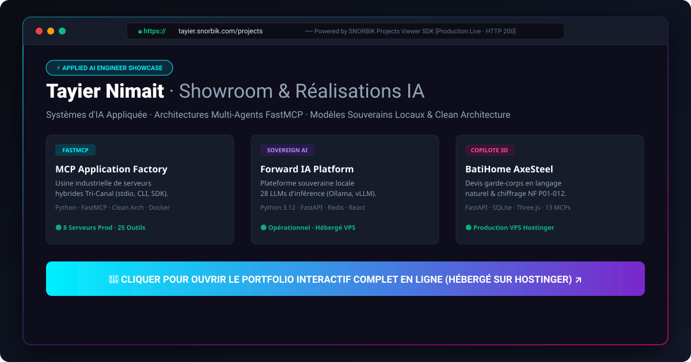
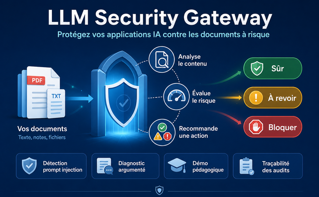
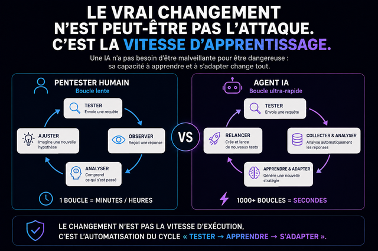
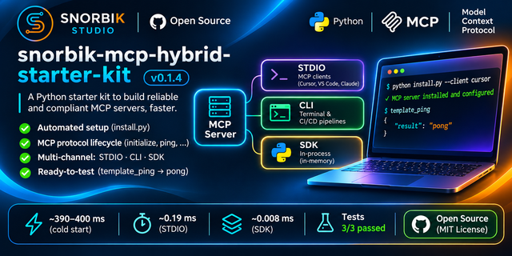
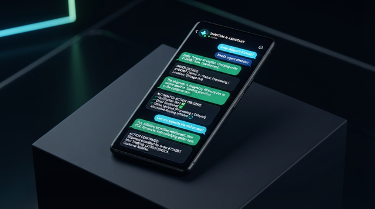
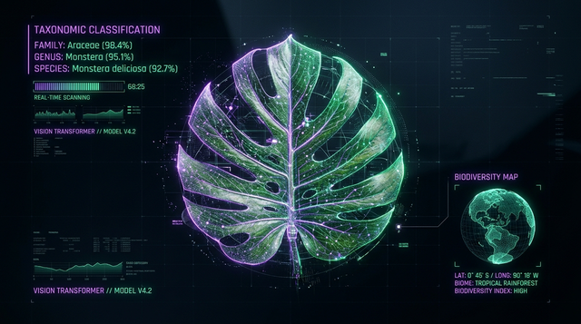
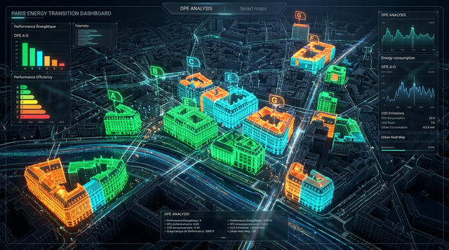
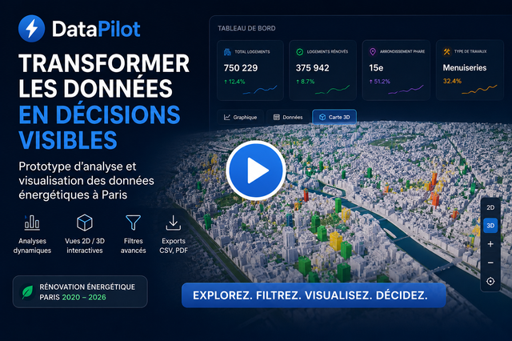

<div align="center">

# ⚡ Tayier Nimait
### Applied AI Engineer · Multi-Agent Systems & FastMCP Architectures

[](https://tayier.snorbik.com)
[](https://tayier.snorbik.com/cv)
[](https://tayier.snorbik.com/projects)
[](https://tayier.snorbik.com/#/docs)
[](https://snorbik.com)

<br/>

<!-- ======================================================================= -->
<!-- 1. VITRINE IMMÉDIATE (PREMIER ÉCRAN DESKTOP — ZERO SCROLL)             -->
<!-- ======================================================================= -->

<a href="https://tayier.snorbik.com" target="_blank" rel="noopener noreferrer">
  
</a>

<p align="center">
  <a href="https://tayier.snorbik.com" target="_blank" rel="noopener noreferrer">
    
  </a>
  &nbsp;&nbsp;
  <a href="https://snorbik-ai.github.io/snorbik-ai/" target="_blank" rel="noopener noreferrer">
    
  </a>
</p>

</div>

---

### 🌐 Accès Rapides aux Plateformes Déployées

| Plateforme | Rôle Opérationnel & Contenu | Lien Direct |
| :--- | :--- | :--- |
| 🧪 **Showroom Déployé** | Portfolio interactif, démos agentiques en direct, catalogue de 70+ projets R&D | [**tayier.snorbik.com** ↗](https://tayier.snorbik.com) |
| 📄 **CV & Profil Ingénieur** | Parcours complet, stack certifiée, engagements de livraison clé-en-main | [**tayier.snorbik.com/cv** ↗](https://tayier.snorbik.com/cv) |
| 📦 **Catalogue des Réalisations** | Fiches d'architecture logicielle, métriques de performance et bancs d'essais | [**tayier.snorbik.com/projects** ↗](https://tayier.snorbik.com/projects) |
| ⚡ **Conteneur GitHub Pages** | Application porteuse React SDK intégrée en conteneur sécurisé plein écran | [**snorbik-ai.github.io/snorbik-ai** ↗](https://snorbik-ai.github.io/snorbik-ai/) |
| 🏢 **Studio B2B SNORBIK** | Ingénierie de solutions numériques et copilotes sur-mesure pour entreprises | [**snorbik.com** ↗](https://snorbik.com) |

---

## 🏛️ Vision & Positionnement Ingénieur IA (2026)

Je conçois et déploie des **systèmes d’IA appliquée et d'ingénierie logicielle** à partir de besoins métier concrets.

Mon approche associe la rigueur du génie logiciel (**Clean Architecture DDD**, typage strict TypeScript/Python, tests de non-régression) au potentiel de l'intelligence artificielle agentique (**FastMCP**, garde-fous déterministes, modèles souverains locaux et inférence cloud optimisée).

De l'audit initial au déploiement en conteneur sous Linux, je livre des dispositifs **immédiatement opérationnels, testables et observables**.

---

## 🧭 Sélection des 12 Projets Phares (Showroom & Réalisations)

### 🛡️ Pôle 1 : Cybersécurité IA & Résilience Système

<table>
  <tr>
    <td width="50%" valign="top">
      <a href="https://github.com/snorbik-ai/llm-security-gateway-showcase">
        
      </a>
      <br/>
      <h4>🛡️ <a href="https://github.com/snorbik-ai/llm-security-gateway-showcase">LLM Security Gateway</a></h4>
      <p><b>Pare-feu applicatif IA & Détection de Prompt Injection</b></p>
      <p><i>Problématique :</i> Risques de fuite de données sensibles (PII) et d'attaques par détournement de prompt (jailbreaks) en amont des modèles.</p>
      <p><i>Solution :</i> Proxy inverse avec validation déterministe de tokens, sanitization PII et détection d'injections en temps réel.</p>
      <p>
        
        
        
      </p>
      <p>
        <a href="https://github.com/snorbik-ai/llm-security-gateway-showcase"><b>📂 Dépôt GitHub ↗</b></a> &nbsp;•&nbsp; 
        <a href="https://tayier.snorbik.com/projects"><b>🧪 Démo Live ↗</b></a>
      </p>
    </td>
    <td width="50%" valign="top">
      <a href="https://github.com/snorbik-ai/snorbik-vps-guardian">
        
      </a>
      <br/>
      <h4>🛡️ <a href="https://github.com/snorbik-ai/snorbik-vps-guardian">SNORBIK VPS Guardian AI</a></h4>
      <p><b>Sentinelle d’autodéfense serveur propulsée par IA locale</b></p>
      <p><i>Problématique :</i> Les sondes de sécurité cloud traditionnelles exposent les journaux système sensibles à des tiers externes.</p>
      <p><i>Solution :</i> Agent sentinelle autonome Bonsai-2b analysant les journaux système et appliquant des blocages iptables signés SHA-256.</p>
      <p>
        
        
        
      </p>
      <p>
        <a href="https://github.com/snorbik-ai"><b>📂 Dépôt Souverain ↗</b></a> &nbsp;•&nbsp; 
        <a href="https://tayier.snorbik.com/projects"><b>🧪 Fiche Projet ↗</b></a>
      </p>
    </td>
  </tr>
</table>

---

### 🤖 Pôle 2 : MCP & Context Engineering (Outils d'Agents)

<table>
  <tr>
    <td width="50%" valign="top">
      <a href="https://github.com/snorbik-ai/mcp-application-factory-showcase">
        
      </a>
      <br/>
      <h4>🤖 <a href="https://github.com/snorbik-ai/mcp-application-factory-showcase">SNORBIK Application Factory</a></h4>
      <p><b>Usine industrielle de serveurs FastMCP Hybrides Tri-Canal</b></p>
      <p><i>Problématique :</i> Les outils MCP standards sont souvent limités à stdio et complexes à tester ou déployer hermétiquement.</p>
      <p><i>Solution :</i> Standard Tri-Canal unifié exécutant la même logique en CLI direct, SDK in-process ou serveur JSON-RPC stdio/SSE.</p>
      <p>
        
        
        
      </p>
      <p>
        <a href="https://github.com/snorbik-ai/mcp-application-factory-showcase"><b>📂 Dépôt GitHub ↗</b></a> &nbsp;•&nbsp; 
        <a href="https://tayier.snorbik.com/projects"><b>🧪 Démo Live ↗</b></a>
      </p>
    </td>
    <td width="50%" valign="top">
      <a href="https://github.com/snorbik-ai/snorbik-projects-viewer-sdk-showcase">
        
      </a>
      <br/>
      <h4>📦 <a href="https://github.com/snorbik-ai/snorbik-projects-viewer-sdk-showcase">Projects Viewer SDK (v2.0)</a></h4>
      <p><b>Composant d’intégration multi-distribution & fail-closed</b></p>
      <p><i>Problématique :</i> Embarquer des applications complètes sans fuite de secrets, sans bloquage CSP et avec 3 modes d'affichage.</p>
      <p><i>Solution :</i> SDK universel (Web React 19, FastMCP #25, CLI, Extension) avec modes Seamless (100%), Window et Card Widget.</p>
      <p>
        
        
        
      </p>
      <p>
        <a href="https://github.com/snorbik-ai/snorbik-projects-viewer-sdk-showcase"><b>📂 Dépôt Showcase ↗</b></a> &nbsp;•&nbsp; 
        <a href="https://snorbik-ai.github.io/snorbik-ai/"><b>⚡ Démo Live ↗</b></a>
      </p>
    </td>
  </tr>
</table>

---

### 🧠 Pôle 3 : Agentic AI & Copilotes Métier 3D

<table>
  <tr>
    <td width="50%" valign="top">
      <a href="https://github.com/snorbik-ai/copilot-rdv-showcase">
        
      </a>
      <br/>
      <h4>🗓️ <a href="https://github.com/snorbik-ai/copilot-rdv-showcase">SNORBIK Copilot RDV</a></h4>
      <p><b>Assistant conversationnel et visuel de prise de rendez-vous</b></p>
      <p><i>Problématique :</i> Les formulaires de réservation statiques sont rigides et génèrent des abandons ou des erreurs d'horaires.</p>
      <p><i>Solution :</i> Copilote split-screen temps réel avec qualification intelligente, vérification de créneaux et scellage iCal/RFC 5545.</p>
      <p>
        
        
        
      </p>
      <p>
        <a href="https://github.com/snorbik-ai/copilot-rdv-showcase"><b>📂 Dépôt GitHub ↗</b></a> &nbsp;•&nbsp; 
        <a href="https://tayier.snorbik.com/projects"><b>🧪 Démo Live ↗</b></a>
      </p>
    </td>
    <td width="50%" valign="top">
      <a href="https://tayier.snorbik.com/projects">
        
      </a>
      <br/>
      <h4>🏗️ <a href="https://tayier.snorbik.com/projects">BatiHome AxeSteel 3D</a></h4>
      <p><b>Configurateur BTP 3D, calepinage NF P01-012 & 13 MCPs</b></p>
      <p><i>Problématique :</i> Le chiffrage manuel de garde-corps prend 48h et génère des erreurs de conformité normatives bloquantes.</p>
      <p><i>Solution :</i> Moteur géométrique déterministe NF P01-012 orchestré par 13 serveurs MCP et visualisation Three.js/WebGL.</p>
      <p>
        
        
        
      </p>
      <p>
        <a href="https://www.axesteel.fr/"><b>🌐 Site Client ↗</b></a> &nbsp;•&nbsp; 
        <a href="https://tayier.snorbik.com/projects"><b>🧪 Fiche Architecture ↗</b></a>
      </p>
    </td>
  </tr>
</table>

---

### 📊 Pôle 4 : Data Intelligence & Modélisation Territoriale

<table>
  <tr>
    <td width="50%" valign="top">
      <a href="https://github.com/snorbik-ai/bio-atlas-agent-showcase">
        
      </a>
      <br/>
      <h4>🗺️ <a href="https://github.com/snorbik-ai/bio-atlas-agent-showcase">Bio-Atlas Agent</a></h4>
      <p><b>Cartographie prédictive & rénovation thermique du bâti parisien</b></p>
      <p><i>Problématique :</i> Identifier et prioriser les passoires thermiques à l'échelle d'une métropole parmi des centaines de milliers de parcelles.</p>
      <p><i>Solution :</i> Ingestion in-memory DuckDB + PyArrow avec scoring multicritère des parcelles et rendu cartographique GeoJSON.</p>
      <p>
        
        
        
      </p>
      <p>
        <a href="https://github.com/snorbik-ai/bio-atlas-agent-showcase"><b>📂 Dépôt GitHub ↗</b></a> &nbsp;•&nbsp; 
        <a href="https://tayier.snorbik.com/projects"><b>🧪 Démo Live ↗</b></a>
      </p>
    </td>
    <td width="50%" valign="top">
      <a href="https://github.com/snorbik-ai/G-Genome-AI-Framework">
        
      </a>
      <br/>
      <h4>🧬 <a href="https://github.com/snorbik-ai/G-Genome-AI-Framework">G-Genome AI Framework</a></h4>
      <p><b>Gouvernance cognitive & modélisation énergétique de 800k+ logements</b></p>
      <p><i>Problématique :</i> Fiabiliser l'évaluation statistique de jeux de données multi-sources pour des modèles décisionnels énergétiques.</p>
      <p><i>Solution :</i> Pipeline Python/Pandas d'audit statistique déterministe avec cartographie thermique et indicateurs de dispersion.</p>
      <p>
        
        
        
      </p>
      <p>
        <a href="https://github.com/snorbik-ai/G-Genome-AI-Framework"><b>📂 Dépôt GitHub ↗</b></a> &nbsp;•&nbsp; 
        <a href="https://tayier.snorbik.com/projects"><b>🧪 Fiche Projet ↗</b></a>
      </p>
    </td>
  </tr>
</table>

---

### 🌐 Pôle 5 : Inférence Souveraine & Moteurs Analytiques

<table>
  <tr>
    <td width="50%" valign="top">
      <a href="https://tayier.snorbik.com/projects">
        
      </a>
      <br/>
      <h4>🖥️ <a href="https://tayier.snorbik.com/projects">Forward IA Platform (v4.0)</a></h4>
      <p><b>Plateforme souveraine de contrôle : 28 LLMs locaux & télémétrie GPU</b></p>
      <p><i>Problématique :</i> Dépendance aux API clouds tiers, coûts imprévisibles et risque d'exfiltration des données sensibles.</p>
      <p><i>Solution :</i> Centre d'orchestration on-premise unifié avec supervision NVML temps réel et flotte FastMCP #21-#28.</p>
      <p>
        
        
        
      </p>
      <p>
        <a href="https://github.com/snorbik-ai"><b>📂 Dépôt Souverain ↗</b></a> &nbsp;•&nbsp; 
        <a href="https://tayier.snorbik.com/projects"><b>🧪 Démo Live ↗</b></a>
      </p>
    </td>
    <td width="50%" valign="top">
      <a href="https://github.com/snorbik-ai/datapilot-ai">
        
      </a>
      <br/>
      <h4>⚡ <a href="https://github.com/snorbik-ai/datapilot-ai">DataPilot AI — Moteur In-Memory</a></h4>
      <p><b>Analyse in-memory DuckDB + PyArrow avec copilote déterministe sub-100ms</b></p>
      <p><i>Problématique :</i> Les gros volumes de données publiques souffrent de requêtes lentes et d'analyses fragmentées.</p>
      <p><i>Solution :</i> Moteur analytique in-memory ultra-rapide couplé à un assistant IA de requêtage sémantique sans latence.</p>
      <p>
        
        
        
      </p>
      <p>
        <a href="https://github.com/snorbik-ai/datapilot-ai"><b>📂 Dépôt GitHub ↗</b></a> &nbsp;•&nbsp; 
        <a href="https://tayier.snorbik.com/projects"><b>🧪 Démo Live ↗</b></a>
      </p>
    </td>
  </tr>
</table>

---

### 🎙️ Pôle 6 : Audio, Voix & Fondations Software Engineering

<table>
  <tr>
    <td width="50%" valign="top">
      <a href="https://tayier.snorbik.com/projects">
        
      </a>
      <br/>
      <h4>🎙️ <a href="https://tayier.snorbik.com/projects">VoxExtract Studio & listen-doc</a></h4>
      <p><b>Clonage vocal F5-TTS, transcription Whisper & synthèse Kokoro</b></p>
      <p><i>Problématique :</i> Coût élevé et latence des API audio cloud pour les flux de transcription et de synthèse documentaire.</p>
      <p><i>Solution :</i> Pipeline multimodal local associant Whisper, F5-TTS et lecteur de documents Kokoro ONNX sub-50ms.</p>
      <p>
        
        
        
      </p>
      <p>
        <a href="https://www.youtube.com/@SNORBIKStudio"><b>🎥 Démo Vidéo ↗</b></a> &nbsp;•&nbsp; 
        <a href="https://tayier.snorbik.com/projects"><b>🧪 Fiche Audio ↗</b></a>
      </p>
    </td>
    <td width="50%" valign="top">
      <a href="https://tayier.snorbik.com/projects">
        
      </a>
      <br/>
      <h4>🏛️ <a href="https://tayier.snorbik.com/projects">Enterprise Multi-Stack (.NET 8 & Django)</a></h4>
      <p><b>Architectures distribuées : Clean Architecture, Onion & Microservices</b></p>
      <p><i>Problématique :</i> Assurer la passerelle et l'interopérabilité entre systèmes transactionnels d'entreprise et services IA modernes.</p>
      <p><i>Solution :</i> API RESTful sécurisées JWT, architecture Onion ASP.NET 8.0, backend Django et composants modulaires React.</p>
      <p>
        
        
        
      </p>
      <p>
        <a href="https://github.com/snorbik-ai/projet-CarBook-Asp.net-8.0-2025"><b>📂 Dépôt GitHub ↗</b></a> &nbsp;•&nbsp; 
        <a href="https://tayier.snorbik.com/projects"><b>🧪 Fiche Projet ↗</b></a>
      </p>
    </td>
  </tr>
</table>

---

## 🛠️ Stack Technologique Maîtrisée

```
IA & LLMs      : FastMCP · Ollama · vLLM · LangGraph · Hugging Face · PyTorch · Kokoro TTS · ONNX
Backend        : Python 3.12 · FastAPI · SQLite · DuckDB · PostgreSQL · Redis · Docker · Linux VPS
Frontend       : React 19 · TypeScript · Clean Architecture · Three.js / WebGL · Tailwind CSS · Vite
Méthodologies  : Domain-Driven Design (DDD) · ASCA · DPN-IA (UI puzzle) · Pre-CICD CodeFocus (0 token IA)
```

---

## 📬 Contact Direct & Échange Professionnel

* 💼 **LinkedIn Officiel :** [linkedin.com/in/tayier-dev-ai-data ↗](https://www.linkedin.com/in/tayier-dev-ai-data/)
* 📧 **Studio B2B SNORBIK :** [contact@snorbik.com](mailto:contact@snorbik.com) — [snorbik.com ↗](https://snorbik.com)
* 🧪 **Showroom Déployé :** [tayier.snorbik.com ↗](https://tayier.snorbik.com)
